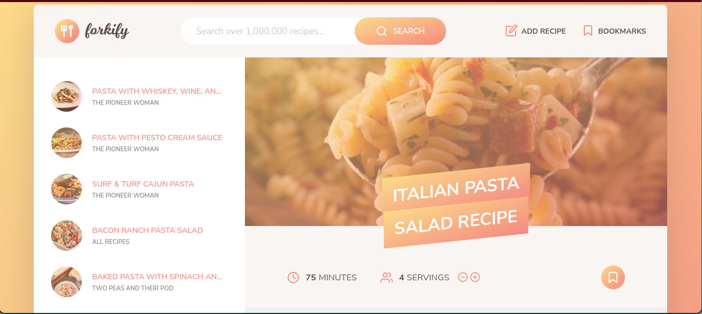

# Forkify

A recipe search and bookmarking app built with vanilla JavaScript. Search for recipes, adjust servings, bookmark favourites, and upload your own recipes to the Forkify API.

> **Live demo:** not deployed yet.



---

## Features

- **Search** recipes by keyword, with paginated results (10 per page)
- **Recipe view** with ingredients, cooking time, and a link to the original source
- **Adjustable servings**: ingredient quantities scale instantly without re-rendering the whole view
- **Bookmarks** that survive a page reload (persisted to `localStorage`)
- **Upload your own recipe** through a modal form; uploaded recipes are saved through the API and marked with a user icon in the recipe view and in search results
- **Shareable URLs**: each recipe has its own hash, so a link opens the right recipe directly

---

## Tech stack

| Concern              | Tool                                            |
| -------------------- | ----------------------------------------------- |
| Language             | JavaScript (ES6+ modules), no framework         |
| Styling              | SCSS                                            |
| Bundler / dev server | [Parcel 2](https://parceljs.org/)               |
| Polyfills            | Babel, `core-js`, `regenerator-runtime`         |
| Fraction display     | `fraction.js`                                   |
| Recipe data          | [Forkify API v2](https://forkify-api.jonas.io/) |

---

## Getting started

**Requirements:** Node.js (developed on v22) and npm.

```bash
git clone https://github.com/PrinceLemayian/forkify.git
cd forkify
npm install
npm start        # dev server with hot reload
npm run build    # production bundle → dist/
```

The app authenticates with the Forkify API using the key in `src/js/config.js`. If you run your own copy, [register for a free key](https://forkify-api.jonas.io/) and replace the value of `KEY` there.

---

## Architecture

The app follows the **Model-View-Controller** pattern. Views connect to the controller through the **publisher-subscriber** pattern: the controller passes handler functions into each view at startup, and the view calls the handler it was given when a user event fires.

```
src/js/
├── model.js        # application state, API calls, bookmark persistence
├── controller.js   # connects the model and views; wires all event handlers
├── helpers.js      # AJAX utility with request timeout
├── config.js       # shared constants (API URL, key, pagination size, timeouts)
└── views/
    ├── View.js            # base class: render, update, spinner, error, message
    ├── recipeView.js      # recipe detail panel
    ├── searchView.js      # search input
    ├── resultsView.js     # search results list
    ├── paginationView.js  # previous / next page buttons
    ├── bookmarksView.js   # bookmarks dropdown
    ├── previewView.js     # single result / bookmark item
    └── addRecipeView.js   # upload modal and form
```

### Key design decisions

**Model** holds all state (`recipe`, `search`, `bookmarks`) and talks to the API. It has no knowledge of the DOM.

**Views** render markup and emit user events. They never call the model directly.

**Controller** is the only layer that touches both. It subscribes handlers to views during `init()`.

**`View.update()`** generates new markup into a document fragment, diffs it against the live DOM node by node, and applies only the changed text content and attributes. This means updating servings or toggling a bookmark changes a handful of nodes rather than replacing the whole component.

**`AJAX`** unifies GET and POST into one function, races the fetch against a configurable timeout, and throws a descriptive error on non-OK responses.

**Ingredient parsing** trims each comma-separated part individually (quantity, unit, description), so a description like `"olive oil"` keeps its internal space while leading/trailing whitespace is removed.

**Upload form reset**: after the success or error message replaces the form, the form is restored when the modal is closed, so the user can submit again without reloading.

**`updateServings` guard**: the function returns `false` and skips the re-render if the new value is non-finite or below 1, or if the current servings value is invalid.

---

## Configuration

All tuneable constants live in `src/js/config.js`:

| Constant          | Default                                        | Purpose                                                |
| ----------------- | ---------------------------------------------- | ------------------------------------------------------ |
| `API_URL`         | `https://forkify-api.jonas.io/api/v2/recipes/` | Base API endpoint                                      |
| `KEY`             | _(your key)_                                   | API key for authenticated requests                     |
| `TIMEOUT_SEC`     | `10`                                           | Seconds before a fetch is aborted                      |
| `RES_PER_PAGE`    | `10`                                           | Search results shown per page                          |
| `MODAL_CLOSE_SEC` | `2.5`                                          | Seconds before the upload modal auto-closes on success |

---

## Possible next steps

- Possible improvements: show total page count in pagination, validate ingredient quantities before submission, support more than six ingredients, add a shopping-list feature.

---

## Credits

This project is based on the Forkify application from **Jonas Schmedtmann's** [_The Complete JavaScript Course_](https://www.udemy.com/course/the-complete-javascript-course/). The design, starter files, and the Forkify API are his. The application was built following the course and extended as described above.
